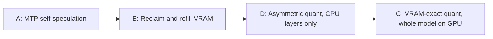

# Qwen 3.8 27B on RX 6700 XT — Bottleneck Diagnosis & Novel Approaches

## Corrections first

- **Qwen 3.8 27B is not MoE.** It is a **dense** hybrid: 64 blocks = 48 Gated-DeltaNet (linear/recurrent) + 16 full-attention (`full_attention_interval = 4`), plus **one built-in MTP head** (`blk.64`, `nextn_predict_layers = 1`, 335 MiB). Every token reads *all* weights, so MoE-style tricks don't apply. But speculation is no longer penalised the way it was on the 35B MoE (EXP-016).
- The "With Afterburner ~1.4 s" figure I gave last turn was an **estimate**, not a measurement, and it compared a different model (14B). Disregard it.
- The server I launched for you wasted VRAM: it loaded `mmproj-BF16` (0.93 GB, unused for text) and defaulted to **4 parallel slots**. That multiplies KV and recurrent state.

## Measurements (llama.cpp b12374 Vulkan, `-fa on`, tg = decode)

| `-ngl` | Decode t/s | ms / token |
|---:|---:|---:|
| 0 (all CPU) | 1.98 | 505 |
| 24 | 3.09 | 324 |
| 32 | 3.73 | 268 |
| **40** | **4.58** | **218** |
| 44 | 4.46 | 224 ← slower: VRAM ceiling / WDDM spill |

| Threads (`-ngl 40`) | 2 | 3 | 4 | 6 | 12 |
|---|---:|---:|---:|---:|---:|
| Decode t/s | 3.67 | 4.52 | **4.75** | 4.73 | 4.49 |

System RAM confirmed at DDR4-3200 dual channel (XMP active), so the theoretical ceiling is 47.7 GiB/s.

## The choke point: DDR4 bandwidth for the CPU-resident 25 layers

Each layer moved from CPU to GPU saves ~6.6 ms. That puts the effective CPU-side weight streaming at **~32 GiB/s**, about 67% of the DDR4 peak. That figure is typical of real-world bandwidth, and the all-CPU run (16 GiB in 505 ms) gives the same number.

Approximate time breakdown at `-ngl 40` (218 ms / token):

| Phase | Bytes / token | Time | Share |
|---|---:|---:|---:|
| CPU streams 25 layers from DDR4 | ~5.3 GiB | **~165 ms** | **~76%** |
| GPU streams 40 layers + output head from GDDR6 | ~9 GiB | ~27 ms | ~12% |
| Sync, PCIe hand-off, kernel launch | — | ~25 ms | ~12% |

**This explains what you see.** The GPU finishes its share in ~27 ms and then idles for ~190 ms while the CPU reads DDR4. That gives roughly 12% utilisation and a cool 55 °C. Two more signs that memory bandwidth is the limit, not compute:

- Throughput **saturates at 4 threads**, and 12 threads is *slower*. More cores are just fighting over the same memory bus.
- `-ngl 44` gets slower because VRAM is already full.

**Rule of thumb:** every GiB of weights left in DDR4 costs about 32 ms per token. The same GiB in VRAM costs about 3 ms.

## Ruled out (with numbers)

| Idea | Why not |
|---|---|
| More CPU threads / priority | Already bandwidth-saturated at 4 threads |
| Stream weights over PCIe to the GPU instead | PCIe 4.0 x16 gives ~25 GB/s in practice, slower than CPU-side DDR4 (32 GiB/s) |
| Infinity Cache residency | Working set is about 9 GB; the 96 MB cache is irrelevant here |
| Overclocking the GPU | The GPU is idle 85% of the time |

## Novel approaches, ranked

### A. Native MTP self-speculation — *no download, test today*  (est. 1.6–2.0×)

At batch size 1 the CPU is **memory-bound with idle ALUs**. Verifying K+1 tokens in one pass streams the 5.3 GiB from DDR4 **once**, not K+1 times, so each extra verified token is nearly free. The model ships its own drafter (the MTP head, 335 MiB, GPU-resident), and this build has `--spec-type draft-mtp`. It also shares the tokenizer, so the 248k-vs-152k vocab barrier does not apply.

- If K=2 averages ~2 accepted tokens per pass: **~8–9 t/s**.
- Risk: the 48 DeltaNet layers hold recurrent state. Rejected drafts need a state rollback, so we must check that this build checkpoints it correctly (`--ctx-checkpoints`) and that output matches at temp 0.
- Optionally stack `ngram-simple` for repetitive tool-call JSON.

### B. Reclaim VRAM, then refill it with the right tensors  (est. 1.15–1.25×)

1. Drop `mmproj` (−0.93 GB), use `-np 1` (one slot instead of four), and keep the KV q8_0 at the context you actually need.
2. Fill the freed space to just under the WDDM cliff, using `-ot` per-tensor placement instead of whole `-ngl` layers to pack VRAM tightly. Each extra GiB moved saves ~29 ms per token.
3. Make sure `token_embd` (0.67 GiB, a lookup that costs ~0 bandwidth) stays on the CPU and never takes VRAM.

Expected: about 1.3–1.5 GiB moved off the CPU, giving **~5.5–6 t/s** without speculation.

### C. VRAM-exact mixed quant: the whole model on the GPU  (est. 3–5×, quality risk)

Set the bit budget to exactly fit about 10.5 GB of VRAM (roughly 2.8–3.0 bpw average via per-tensor `--tensor-type` + imatrix). Then nothing touches DDR4 and the GPU becomes the bottleneck: about 9 GB / ~330 GiB/s, so **~25–35 ms/token (~20–30 t/s)** before MTP. The open question is quality. We would measure it the way we did for the drafters: KL divergence plus blind held-out agentic tasks against the current Q4_K_XL. This needs a BF16 or Q8_0 source download, because requantizing Q4 to Q3 compounds error.

### D. Asymmetric "bandwidth-priced" quantization  (est. 1.3–1.5×, moderate quality risk)

A middle ground between B and C. Keep GPU-resident layers at Q4/Q5, and requantize **only the CPU-resident layers' FFNs** (69% of layer bytes) to ~3 bpw. Choose which layers live on the CPU by **quantization sensitivity** (reusing `profile_layer_importance.py`, but scoring quant error instead of pruning). That cuts CPU bytes by about a third, giving ~6–6.5 t/s, or about 10+ t/s combined with A.

### E. Intra-layer CPU‖GPU concurrent split  (est. ≤1.1×, high effort — deferred)

Split each FFN's rows between the GPU and CPU so both run at the same time instead of one after the other. The gain is capped at hiding the ~27 ms GPU share. That isn't worth a custom Vulkan/ggml fork yet.

## Proposed next step

Run **A + B** together as one experiment (config only, no downloads), with output-equivalence checks at temp 0. Then decide whether C is worth a ~54 GB BF16 download.
