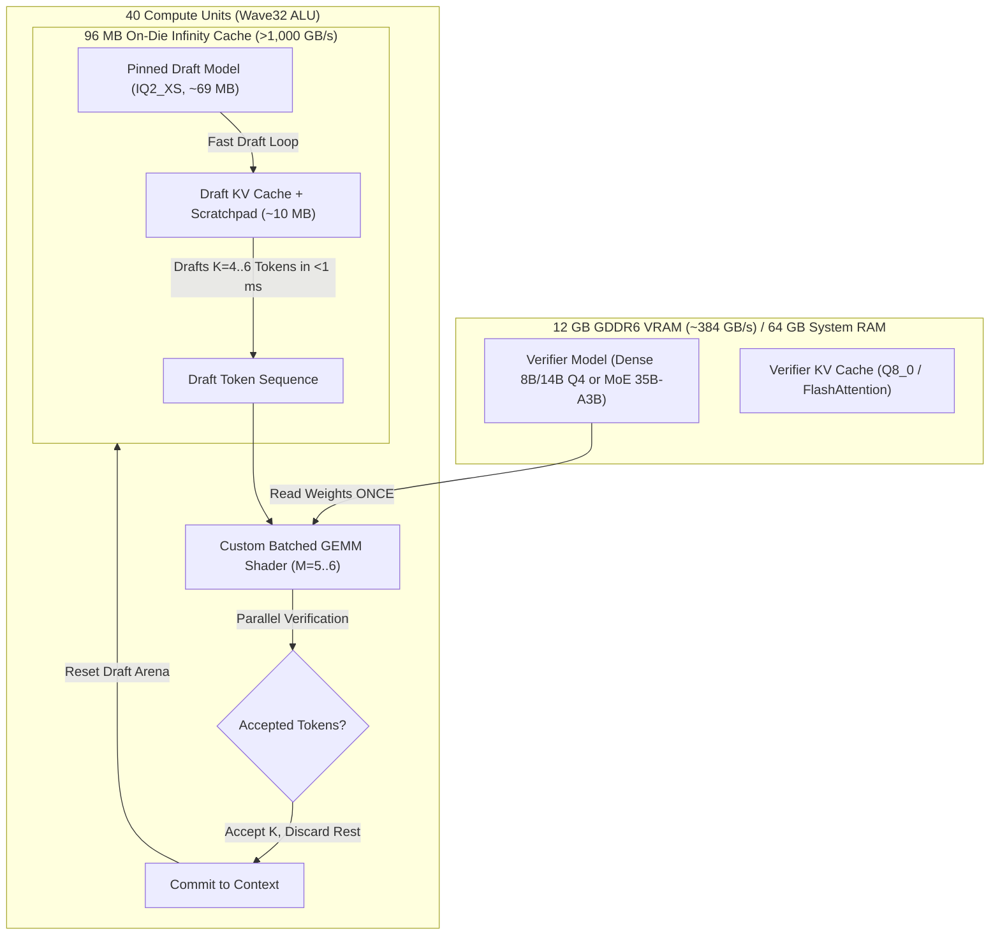
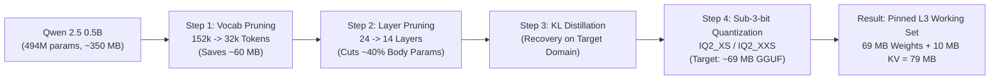
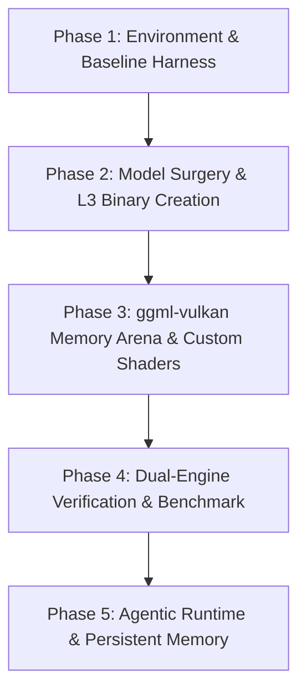

# Project Strata: Navi 22 Hardware-Software Co-Design Architecture & Implementation Plan

> [!IMPORTANT]
> **Core Objective:** Eliminate the 192-bit GDDR6 memory bandwidth bottleneck on the AMD Radeon RX 6700 XT (Navi 22 / `gfx1031`) by architecting a dual-tier speculative inference system ("JEV"). An ultra-compact draft model is permanently pinned inside the 96 MB on-die Infinity Cache (>1 TB/s effective bandwidth), while a larger verifier model executes batched verification on the 40 Compute Units.

---

## 1. System & Hardware Baseline

```
+-----------------------------------------------------------------------------------------+
|                                HOST SYSTEM (3D2A-STUDIO)                                |
+------------------------------------+----------------------------------------------------+
| Component                          | Detected Configuration                             |
+------------------------------------+----------------------------------------------------+
| Operating System                   | Windows 11 Pro 64-bit (Build 26300, UEFI, ReBAR)   |
| Host Processor                     | AMD Ryzen 5 5600 (6 Cores / 12 Threads)            |
| System Memory                      | 64 GB DDR4-3200 (Dual Channel, 2x32 GB)            |
| Graphics Card                      | AMD Radeon RX 6700 XT 12 GB (PowerColor Fighter)   |
| Silicon Architecture               | Navi 22 (RDNA 2, gfx1031, WGP/Wave32, 40 CUs)      |
| On-Die L3 Cache (Infinity Cache)   | 96 MB SRAM (>1,000 GB/s effective bandwidth)       |
| Dedicated VRAM                     | 12 GB GDDR6 across 192-bit bus (~384 GB/s)         |
| Active Display Driver              | AMD Adrenalin 32.0.21045.16010                      |
| Storage                            | 1 TB NVMe SSD (TEAM TM8FP6001T)                    |
| Staged Models                      | Qwen3.6-35B-A3B-UD-Q4_K_XL.gguf (22.8 GB), mmproj  |
+------------------------------------+----------------------------------------------------+
```

---

## 2. Architectural Blueprint: The Infinity Cache Co-Design

Autoregressive token generation (batch size = 1) is strictly bound by the 192-bit bus (384 GB/s). Standard 7B–14B models read their entire weight matrix for every generated token, leaving the 40 Compute Units (13+ TFLOPS) starving for memory.



### 2.1 The Two Execution Tiers

1. **Tier 1: L3-Resident Draft Engine (<85 MB Total Footprint)**
   - Resides permanently in the 96 MB Infinity Cache.
   - Sourced from a distilled/pruned model (e.g. Qwen 2.5 0.5B).
   - Generates 4 to 6 candidate tokens sequentially at cache line speeds (>1 TB/s) without touching GDDR6.

2. **Tier 2: Batched GDDR6 Verifier**
   - High-capacity model (e.g. Qwen 2.5 7B/14B or Qwen 35B-A3B).
   - Wakes up once per cycle and reads weights from memory **one time** to evaluate all candidate tokens in a single parallel forward pass ($M = K + 1$).
   - Mathematically identical output to running the verifier standalone, but delivers **2.0x to 3.2x** higher token throughput.

---

## 3. Model Surgery: Compressing Qwen into <80 MB

To guarantee that the draft model never spills into GDDR6, its weights, KV cache, and activations must fit within 80–85 MB, leaving 10–15 MB headroom for L3 line conflicts.



### Surgery Specifications:
1. **Vocabulary Trimming (151,936 $\rightarrow$ 32,768 tokens):**
   - Qwen's 152k vocabulary consumes ~76 MB in Q4 for `embed_tokens` and `lm_head` alone.
   - Slicing to a power-of-two agentic vocabulary (English planning, code, JSON, shell, markdown, special tokens, and byte-fallbacks) shrinks the vocabulary tables to ~16.5 MB.
   - The runtime maintains a 128 KB translation table (`draft_to_verifier_id[32768]`) to map drafted token IDs directly into the verifier's full token space.
2. **Layer Pruning (24 $\rightarrow$ 14 layers):**
   - Redundant intermediate layers (measured via cosine similarity) are removed, reducing the parameter count from ~387M down to ~235M.
3. **Sub-3-Bit Quantization:**
   - Quantized to `IQ2_XS` (~2.35 bpw) yields a final binary footprint of **~69 MB**.
   - With an 8k context Q8_0 KV cache (~8–10 MB), the entire active working set is **<80 MB**.

---

## 4. Verifier Engine: Dense vs. MoE on 12 GB VRAM + 64 GB RAM

The system workspace contains `Qwen3.6-35B-A3B-UD-Q4_K_XL.gguf` (22.8 GB total weights, ~3B active parameters per token), and the machine is equipped with 64 GB DDR4.

### Trade-Off Comparison:

| Feature | Option A: Dense Verifier (Qwen 2.5 7B/14B Q4) | Option B: MoE Verifier (Qwen 35B-A3B Q4) |
| :--- | :--- | :--- |
| **VRAM Placement** | 100% in 12 GB VRAM (5.5–8.5 GB) | Hybrid split: Active layers in VRAM, remainder in 64 GB DDR4 |
| **Decoded Bandwidth** | Reads full 5–8 GB per verification step | Reads only ~2–3 GB active expert weights per step |
| **Draft Batching ($K=5$)** | Zero expert explosion; linear memory read | Risk: Multiple draft tokens route to disparate experts |
| **L3 Cache Safety** | Clean streaming; minimal cache eviction | Expert thrashing risk if routing jumps across 64+ matrices |
| **Recommended Policy** | **Primary benchmark / First target** | **Advanced agentic target with strict routing rules** |

### MoE Guardrails for Navi 22:
If deploying `Qwen3.6-35B-A3B`:
1. **Cap Draft Horizon:** Restrict $K = 2$ or $3$ (instead of 5 or 6) so drafted tokens share common expert routes.
2. **Expert Coalescing:** Group tokens by routed Expert ID in the Vulkan shader so each expert matrix is fetched at most once per cycle.
3. **Arena Isolation:** Store the 80 MB draft model in a dedicated pinned device-local arena, keeping MoE weight transfers strictly in standard streaming channels.

---

## 5. Host & Silicon Tuning Matrix (Windows 11 + Navi 22)

```
+-----------------------------------------------------------------------------------------+
|                                ADRENALIN / HARDWARE PROFILE                             |
+--------------------------+-----------------------+--------------------------------------+
| Setting                  | Target Value          | Technical Rationale                  |
+--------------------------+-----------------------+--------------------------------------+
| VRAM Max Frequency       | 2112 – 2150 MHz       | Widens the 192-bit memory bottleneck |
| VRAM Timing              | Fast Timings Enabled  | Reduces GDDR6 latency                |
| GPU Core Voltage         | 1125 – 1160 mV        | Undervolt cuts heat during prefill   |
| GPU Core Frequency       | Min 2400 / Max 2650   | Caps unnecessary compute power/heat  |
| Power Limit              | +15%                  | Eliminates clock dips under heavy PL |
| Fan Curve                | 65%–75% at 70°C       | Maintains low hotspot temperatures   |
| Zero RPM                 | Disabled              | Prevents thermal soak during idle    |
| Resizable BAR (SAM)      | Enabled in BIOS/AMD   | Direct CPU/GPU 12 GB VRAM mapping    |
| Windows HAGS             | Disabled if VK Errors | Avoids VK_ERROR_DEVICE_LOST timeouts |
+--------------------------+-----------------------+--------------------------------------+
```

---

## 6. Phased Implementation Roadmap



### Phase 1: Environment Setup & Automated Baseline Harness
- Install native host prerequisites (Git, Python 3.11/3.12, CMake, Ninja, Vulkan SDK).
- Clone and build `llama.cpp` natively with `-DGGML_VULKAN=ON`.
- Build an automated benchmarking script (`strata_bench.ps1`) executing `llama-bench` across context lengths (512, 2048, 4096) to establish baseline tokens/sec for:
  - Dense 7B Q4_K_M
  - Dense 14B Q4_K_M
  - Qwen 35B-A3B (hybrid VRAM/RAM offload)

### Phase 2: Model Surgery Pipeline
- Develop `scripts/vocab_prune.py`:
  - Tokenizes 50 MB domain text (planning, code, JSON, tools).
  - Retains top 32,768 tokens + byte fallbacks + control tokens.
  - Generates trimmed `tokenizer.json` and 128 KB mapping table.
- Develop `scripts/layer_prune.py`:
  - Evaluates cosine similarity across layers on Qwen 2.5 0.5B.
  - Slices network from 24 to 14 layers.
- Distill & Quantize:
  - Export pruned weights to GGUF.
  - Quantize using `llama-quantize` to `IQ2_XS` (targeting $\le 70$ MB).

### Phase 3: Runtime Customization (Vulkan Co-Design)
- **Pinned Device Memory:** Allocate a dedicated `VK_MEMORY_PROPERTY_DEVICE_LOCAL_BIT` buffer (<85 MB) locked to prevent OS eviction.
- **Wave32 Matrix Kernel:** Implement/optimize small-$M$ GEMM SPIR-V shader ($M = 2..8$, $N$, $K$) optimized for Navi 22's 40 CUs and native Wave32 `v_dot4_i32_i8` instructions.
- **Token Remapping Kernel:** On-device mapping of drafted token IDs through the 128 KB translation buffer before verifier dispatch.

### Phase 4: Integration Benchmarking & Validation
- Run dual-engine speculative execution (`--model-draft <pruned_qwen.gguf> --model <verifier.gguf>`).
- Measure draft acceptance rate ($\alpha$), time-per-draft-step, and net generated tokens/second.
- Verify output equivalence against standalone verifier (0% quality loss).

### Phase 5: Strata Local Agentic Interface & Memory Protocol
- Configure native tool execution (Windows command dispatch, Event Viewer inspection, Git operations).
- Implement persistent memory digest (`MEMORY/DIGEST.md`, `MEMORY/LESSONS.md`, `MEMORY/EXPERIMENT_LOG.md`) per the AGENTS.md protocol.
- Full local telemetry: expose exact CLI invocations, GPU power/temperature, and VRAM residency.
